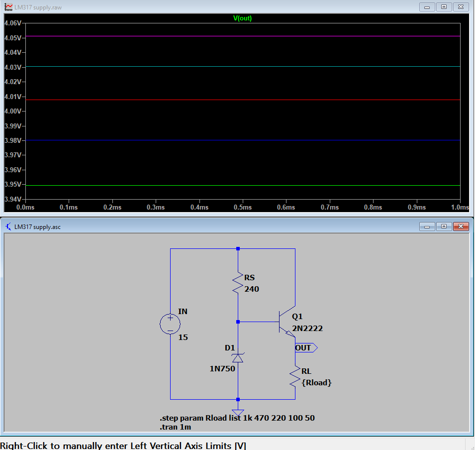
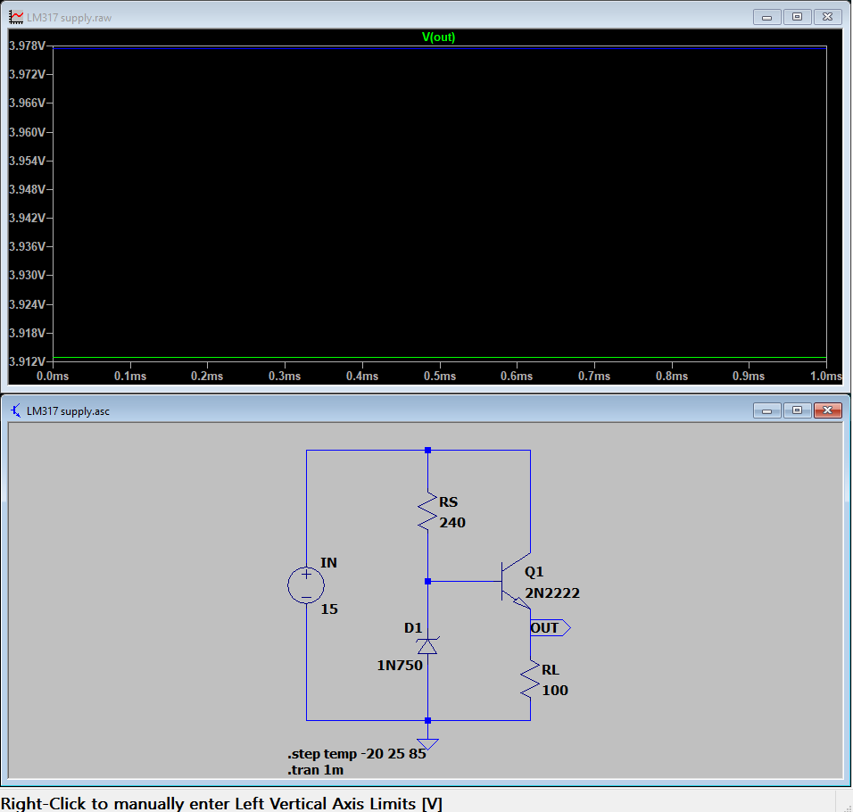

# Adjustable DC Power Supply

*Analog design and PCB layout*

**Status:** Stage 1 (discrete warm-up regulator) simulated and characterised. Stage 2 (LM317) in progress: output range verified in simulation; load, line and temperature tests still to do. KiCad layout not started yet.

## 1. Project goal

Design a small bench power supply around the LM317 adjustable linear regulator: a board fed from a DC wall adapter, with a potentiometer to set the output anywhere in its range. The design is verified by simulation in LTspice before the PCB is laid out in KiCad.

### Target specification

| Parameter | Target |
|---|---|
| Input voltage | 15 V DC (wall adapter) |
| Output voltage | Adjustable, 1.25 V to approx. 12 V |
| Maximum load current | 1 A |
| PCB size | 40 × 40 mm |

## 2. Background: linear regulators

A voltage regulator turns a higher, unsteady input voltage into a lower, steady output that holds constant when the input changes or the load draws more current. A linear regulator does this with a pass transistor acting as a variable valve between input and output. The excess voltage is dropped across that transistor and dissipated as heat, P = (Vin − Vout) × Iload. Linear regulators are less efficient than switching regulators, but simple and electrically quiet.

The LM317 is a three-pin (IN, OUT, ADJ) adjustable linear regulator. Internally it is a pass transistor (Darlington pair) controlled by an error amplifier that compares the output with an internal 1.25 V bandgap reference, plus current-limit and thermal-shutdown protection. It holds 1.25 V between OUT and ADJ. With R1 between OUT and ADJ and R2 from ADJ to ground, the output is:

```
Vout = 1.25 V × (1 + R2/R1) + I_ADJ × R2      (I_ADJ ≈ 50 µA)
```

Before simulating the LM317, a discrete regulator without feedback was built as a warm-up, to see the limitations that feedback is meant to fix.

## 3. Stage 1: Zener + emitter-follower regulator

### Operating principle

A Zener diode in reverse breakdown holds the transistor's base at a nearly fixed voltage. In the emitter-follower configuration (collector to the supply, output at the emitter), the emitter sits one base-emitter drop (≈ 0.65 V) below the base. The Zener therefore sets the output voltage, while the transistor supplies the load current from the 15 V rail. The Zener only has to supply the small base current, I_B = I_load / β.

This circuit has a fixed output (set by the choice of Zener) and no feedback: nothing measures the output and corrects it.

### Components

| Ref | Value | Role |
|---|---|---|
| IN | 15 V DC source | Input supply |
| RS | 240 Ω | Zener feed resistor (biases D1, supplies base current) |
| D1 | 1N750 (4.7 V Zener) | Voltage reference at the base node |
| Q1 | 2N2222 NPN | Pass transistor, emitter follower |
| RL | Swept `{Rload}` | Simulated load |

### Design calculations

- **Expected output:** Vout ≈ Vz − V_BE ≈ 4.7 − 0.65 ≈ 4.05 V.
- **Feed current:** I_RS = (15 − 4.7) / 240 Ω ≈ 43 mA. This must cover the worst-case base current (≈ 1.6 mA at 80 mA load with a conservative β of 50) plus enough Zener current to stay in breakdown.
- **Zener dissipation (no load):** 4.7 V × 43 mA ≈ 200 mW, within the 1N750's 500 mW rating.
- **RS dissipation:** 10.3 V × 43 mA ≈ 440 mW, so a ½ W resistor is required in hardware.
- **Transistor dissipation at 80 mA:** (15 − 4) × 0.08 ≈ 0.88 W. This exceeds what a TO-92 2N2222 can dissipate (approx. 0.5–0.6 W). A hardware build would need a larger transistor (e.g. BD139) or a lower maximum load. The simulator does not flag this.

Design trade-off: an initial value of 1 kΩ (≈ 10 mA feed current) was calculated as the minimum sensible choice. The 240 Ω used here gives a stiffer reference, since the base current is a smaller fraction of the feed current, at the cost of higher standby dissipation.

## 4. Stage 1 simulation results (LTspice)

### 4.1 Load regulation

The load was swept with `.step param Rload list 1k 470 220 100 50` (approx. 4 mA to 80 mA).



*Figure 1: V(out) for five load resistances (Vin = 15 V).*

| Load | Load current | V(out) |
|---|---|---|
| 1 kΩ | ≈ 4 mA | 4.051 V |
| 470 Ω | ≈ 9 mA | ≈ 4.03 V |
| 220 Ω | ≈ 18 mA | ≈ 4.008 V |
| 100 Ω | ≈ 40 mA | ≈ 3.98 V |
| 50 Ω | ≈ 79 mA | 3.949 V |

```
Load regulation = (4.051 − 3.949) / 4.051 ≈ 2.5 %
```

The output falls as load current rises, for two reasons: V_BE increases with emitter current, and the larger base current is taken from the Zener's bias current, pulling the Zener voltage down.

### 4.2 Line regulation

The input was swept with `.step param Vin list 12 15 18` at a fixed 100 Ω load.


*Figure 2: V(out) for Vin = 12, 15 and 18 V (RL = 100 Ω).*

V(out) moved from ≈ 3.961 V at 12 V input to ≈ 3.996 V at 18 V input: about 35 mV for a 6 V change, or roughly 6 mV/V. The 15 V result (3.980 V) agrees with the 100 Ω point of the load sweep. The output follows the input because a higher input pushes more current through RS and the Zener, and the Zener voltage rises slightly with current.

### 4.3 Temperature drift

Temperature was swept with `.step temp -20 25 85` at Vin = 15 V and RL = 100 Ω.



*Figure 3: V(out) at −20 °C, 25 °C and 85 °C.*

The output varied over a range of about 66 mV (≈ 3.912 V to ≈ 3.978 V) across the 105 °C span. Two mechanisms contribute: V_BE decreases by about 2 mV/°C, and the Zener voltage has its own temperature coefficient. Open item: identify which trace corresponds to which temperature, to determine whether the two effects add or partly cancel.

## 5. Stage 2: LM317 regulator

### Circuit

Simulated in LTspice with the LT317A model (Analog Devices' equivalent of the LM317). File: `simulation/lm317_regulator.asc`.

| Ref | Value | Role |
|---|---|---|
| IN | 15 V DC source | Input supply |
| U1 | LT317A | Adjustable linear regulator |
| R1 | 240 Ω (OUT to ADJ) | Sets the 5.2 mA programming current (1.25 V / 240 Ω), which also meets the minimum load requirement |
| R2 | Swept `{R2}` (ADJ to ground) | Sets the output voltage |
| C1 | 0.1 µF | Input decoupling |
| C2 | 1 µF | Output capacitor, improves transient response |
| C3 | 10 µF (ADJ to ground) | Bypasses the ADJ pin to improve ripple rejection |
| D1 | 1N4148, cathode at IN | Discharges the output capacitor if the input is shorted |
| D2 | 1N4148, cathode at OUT | Discharges C3 if the output is shorted |
| RL | 100 Ω | Load |

Both diodes are reverse-biased in normal operation. Their orientation is confirmed by the results: a reversed D1 would pull the output up towards the input (≈ 14.3 V), and a reversed D2 would clamp OUT-to-ADJ below 1.25 V, so neither could produce the regulated outputs below.

### 5.1 Output voltage range

R2 was swept with `.step param R2 list 10 500 1k 1.5k 2k 2.2k` at Vin = 15 V and RL = 100 Ω. (10 Ω is used instead of 0 Ω, which LTspice does not accept.) Expected values come from Vout = 1.25 × (1 + R2/240) + 50 µA × R2.


*Figure 4: V(out) for six values of R2 (Vin = 15 V, RL = 100 Ω).*

| R2 | Calculated Vout | Simulated Vout (read from plot) |
|---|---|---|
| 10 Ω | 1.30 V | ≈ 1.3 V |
| 500 Ω | 3.88 V | ≈ 3.9 V |
| 1 kΩ | 6.51 V | ≈ 6.5 V |
| 1.5 kΩ | 9.14 V | ≈ 9.2 V |
| 2 kΩ | 11.77 V | ≈ 11.8 V |
| 2.2 kΩ | 12.82 V | ≈ 12.9 V |

The simulated outputs agree with the calculation across the full range, confirming the design covers approx. 1.3 V to 12.8 V. At the top setting the regulator has only ≈ 2.2 V of headroom; it still regulates at this light load (≈ 130 mA), but dropout at higher currents is still to be checked.

Debugging note: the first run oscillated between about −4.5 V and +5 V and failed to finish. The cause was a missing ground connection. A negative output was the giveaway, since an LM317 cannot produce one.

## 6. Summary and comparison

| Metric | Zener + emitter follower (measured) | LM317 (datasheet, typical) |
|---|---|---|
| Load regulation | ≈ 2.5 % (4–80 mA) | ≈ 0.1 % |
| Line regulation | ≈ 6 mV/V | ≈ 0.01 %/V |
| Temperature drift | ≈ 66 mV over −20…85 °C | Low (bandgap reference) |
| Adjustable output | No (set by Zener) | Yes (R1/R2 divider) |

LM317 values are approximate typical figures and will be confirmed by simulating the LM317 under the same conditions in Stage 2.

**Conclusion:** without feedback, the regulator's output depends on load current, input voltage and temperature. A feedback regulator such as the LM317 measures its own output against a stable reference and corrects for all three, and its output can be set with a resistor ratio.

## 7. Next steps

- [x] **Stage 2:** build the LM317 circuit in LTspice and verify the output range (R2 swept up to 2.2 kΩ).
- [ ] Set the LM317 to ≈ 4.05 V and repeat the load, line and temperature sweeps for a direct comparison with Stage 1.
- [ ] Add a load-step test (10 mA → 1 A), input-ripple rejection with and without the 10 µF ADJ capacitor, and find the dropout point at the top of the output range.
- [ ] Calculate worst-case regulator dissipation and select a heatsink.
- [ ] **Stage 3:** draw the schematic in KiCad, including protection diodes, and lay out a 40 × 40 mm PCB.
