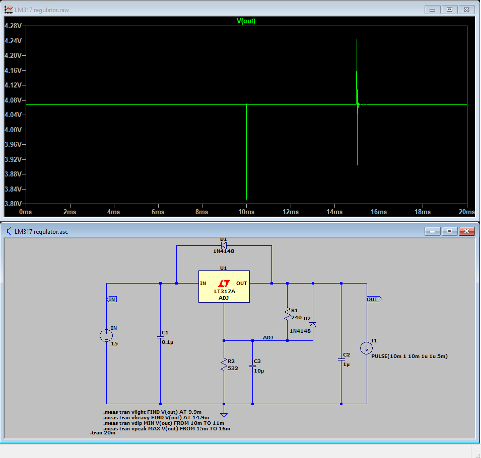
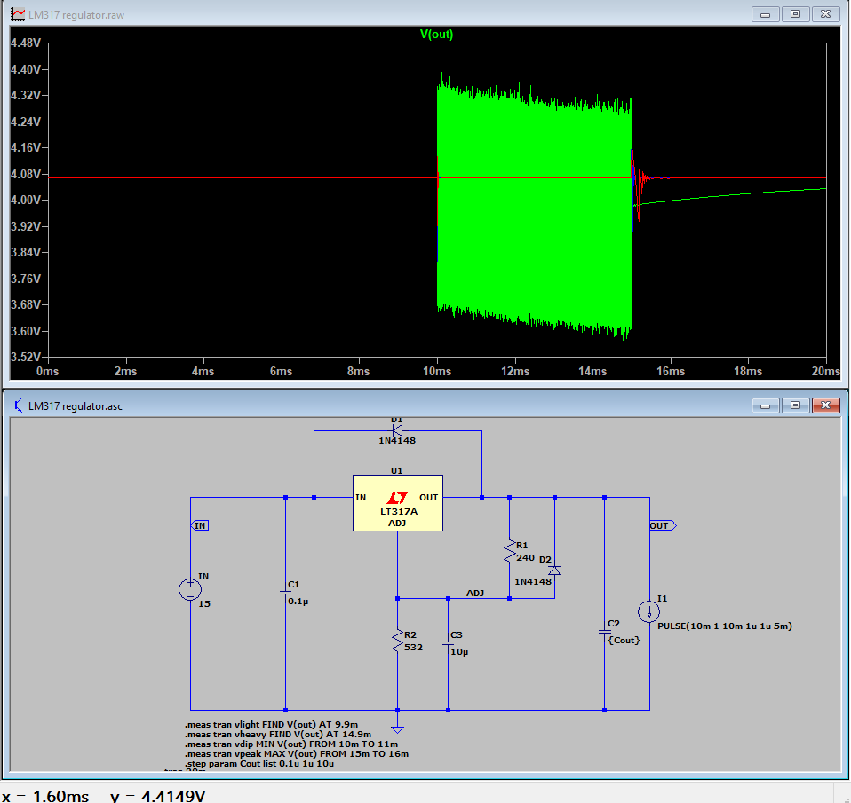
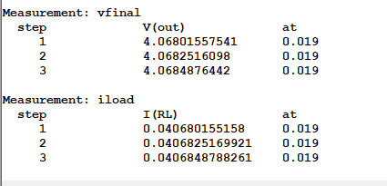
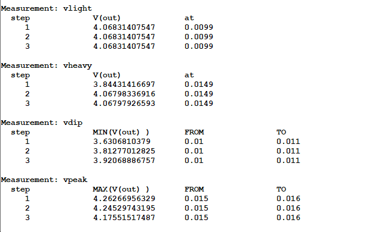
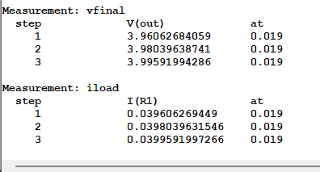
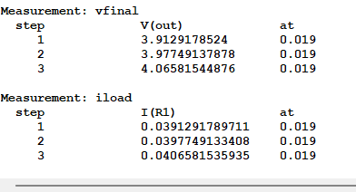

# Adjustable DC Power Supply

*Analog design and PCB layout*

**Status:** Stage 1 (discrete warm-up regulator) and Stage 2 (LM317 output range, regulation and load-step tests) simulated and characterised. Ripple-rejection and dropout tests are next. KiCad layout not started yet.

## 1. Project goal

Design a small bench power supply around the LM317 adjustable linear regulator: a board fed from a DC wall adapter, with a potentiometer to set the output anywhere in its range. The design is verified by simulation in LTspice before the PCB is laid out in KiCad.

### Target specification

| Parameter | Target |
|---|---|
| Input voltage | 15 V DC (wall adapter) |
| Output voltage | Adjustable, 1.25 V to approx. 12 V |
| Maximum load current | 1 A |
| PCB size | 40 × 40 mm |

## 2. Background: linear regulators

A voltage regulator turns a higher, unsteady input voltage into a lower, steady output that holds constant when the input changes or the load draws more current. A linear regulator does this with a pass transistor acting as a variable valve between input and output. The excess voltage is dropped across that transistor and dissipated as heat, P = (Vin − Vout) × Iload. Linear regulators are less efficient than switching regulators, but simple and electrically quiet.

The LM317 is a three-pin (IN, OUT, ADJ) adjustable linear regulator. Internally it is a pass transistor (Darlington pair) controlled by an error amplifier that compares the output with an internal 1.25 V bandgap reference, plus current-limit and thermal-shutdown protection. It holds 1.25 V between OUT and ADJ. With R1 between OUT and ADJ and R2 from ADJ to ground, the output is:

```
Vout = 1.25 V × (1 + R2/R1) + I_ADJ × R2      (I_ADJ ≈ 50 µA)
```

Before simulating the LM317, a discrete regulator without feedback was built as a warm-up, to see the limitations that feedback is meant to fix.

## 3. Stage 1: Zener + emitter-follower regulator

File: `simulation/zener_follower_regulator.asc`

### Operating principle

A Zener diode in reverse breakdown holds the transistor's base at a nearly fixed voltage. In the emitter-follower configuration (collector to the supply, output at the emitter), the emitter sits one base-emitter drop (≈ 0.65 V) below the base. The Zener therefore sets the output voltage, while the transistor supplies the load current from the 15 V rail. The Zener only has to supply the small base current, I_B = I_load / β.

This circuit has a fixed output (set by the choice of Zener) and no feedback: nothing measures the output and corrects it.

### Components

| Ref | Value | Role |
|---|---|---|
| IN | 15 V DC source | Input supply |
| RS | 240 Ω | Zener feed resistor (biases D1, supplies base current) |
| D1 | 1N750 (4.7 V Zener) | Voltage reference at the base node |
| Q1 | 2N2222 NPN | Pass transistor, emitter follower |
| RL | Swept `{Rload}` | Simulated load |

### Design calculations

- **Expected output:** Vout ≈ Vz − V_BE ≈ 4.7 − 0.65 ≈ 4.05 V.
- **Feed current:** I_RS = (15 − 4.7) / 240 Ω ≈ 43 mA. This must cover the worst-case base current (≈ 1.6 mA at 80 mA load with a conservative β of 50) plus enough Zener current to stay in breakdown.
- **Zener dissipation (no load):** 4.7 V × 43 mA ≈ 200 mW, within the 1N750's 500 mW rating.
- **RS dissipation:** 10.3 V × 43 mA ≈ 440 mW, so a ½ W resistor is required in hardware.
- **Transistor dissipation at 80 mA:** (15 − 4) × 0.08 ≈ 0.88 W. This exceeds what a TO-92 2N2222 can dissipate (approx. 0.5–0.6 W). A hardware build would need a larger transistor (e.g. BD139) or a lower maximum load. The simulator does not flag this.

Design trade-off: an initial value of 1 kΩ (≈ 10 mA feed current) was calculated as the minimum sensible choice. The 240 Ω used here gives a stiffer reference, since the base current is a smaller fraction of the feed current, at the cost of higher standby dissipation.

## 4. Stage 1 simulation results (LTspice)

**Measurement method:** all values below were taken with `.meas tran vfinal FIND V(out) AT 19m` (and the equivalent for load current), read from the SPICE error log for each step. The screenshots show the waveforms; the tables give the exact measured values.

### 4.1 Load regulation

Load swept with `.step param Rload list 50 100 220 470 1k` at Vin = 15 V.


*Figure 1: V(out) for five load resistances (Vin = 15 V).*

| Load | Load current | V(out) |
|---|---|---|
| 50 Ω | 79.0 mA | 3.94954 V |
| 100 Ω | 39.8 mA | 3.98040 V |
| 220 Ω | 18.2 mA | 4.00776 V |
| 470 Ω | 8.58 mA | 4.03043 V |
| 1 kΩ | 4.05 mA | 4.05131 V |

```
Load regulation = (4.05131 − 3.94954) / 4.05131 ≈ 2.51 %   (101.8 mV drop, 4 → 79 mA)
```

The output falls as load current rises, for two reasons: V_BE increases with emitter current, and the larger base current is taken from the Zener's bias current, pulling the Zener voltage down.

### 4.2 Line regulation

Input swept with `.step param Vin list 12 15 18` at a fixed 100 Ω load.


*Figure 2: V(out) for Vin = 12, 15 and 18 V (RL = 100 Ω).*

| Vin | V(out) |
|---|---|
| 12 V | 3.96063 V |
| 15 V | 3.98040 V |
| 18 V | 3.99592 V |

```
Line regulation = (3.99592 − 3.96063) / 6 V ≈ 5.88 mV/V   (≈ 0.15 %/V)
```

The output follows the input because a higher input pushes more current through RS and the Zener, and the Zener voltage rises slightly with current. The 15 V result matches the 100 Ω point of the load sweep exactly.

### 4.3 Temperature drift

Temperature swept with `.step temp -20 25 85` at Vin = 15 V and RL = 100 Ω.


*Figure 3: V(out) at −20 °C and 25 °C (the 85 °C trace lies above the plotted window).*

| Temperature | V(out) |
|---|---|
| −20 °C | 3.91292 V |
| 25 °C | 3.97749 V |
| 85 °C | 4.06582 V |

```
Drift = 4.06582 − 3.91292 = 152.9 mV over 105 °C   (≈ +1.46 mV/°C)
```

The output rises with temperature. V_BE falls by about 2 mV/°C, which on its own would raise the output by about 2 mV/°C; the 4.7 V Zener's slightly negative temperature coefficient partly offsets this, leaving a net drift of about +1.46 mV/°C.

Correction: an earlier plot-based estimate gave 66 mV, because the 85 °C trace was outside the plotted window. The `.meas` values above replace it.

## 5. Stage 2: LM317 regulator

File: `simulation/lm317_regulator.asc`. Simulated with the LT317A model (Analog Devices' equivalent of the LM317).

### Circuit

| Ref | Value | Role |
|---|---|---|
| IN | 15 V DC source | Input supply |
| U1 | LT317A | Adjustable linear regulator |
| R1 | 240 Ω (OUT to ADJ) | Sets the 5.2 mA programming current (1.25 V / 240 Ω), which also meets the minimum load requirement |
| R2 | ADJ to ground | Sets the output voltage (swept in 5.1, 532 Ω in 5.2) |
| C1 | 0.1 µF | Input decoupling |
| C2 | 1 µF | Output capacitor, improves transient response |
| C3 | 10 µF (ADJ to ground) | Bypasses the ADJ pin to improve ripple rejection |
| D1 | 1N4148, cathode at IN | Discharges the output capacitor if the input is shorted |
| D2 | 1N4148, cathode at OUT | Discharges C3 if the output is shorted |
| RL | 100 Ω, or swept | Load |

Both diodes are reverse-biased in normal operation. Their orientation is confirmed by the results: a reversed D1 would pull the output up towards the input (≈ 14.3 V), and a reversed D2 would clamp OUT-to-ADJ below 1.25 V, so neither could produce the regulated outputs below.

### 5.1 Output voltage range

R2 swept with `.step param R2 list 10 500 1k 1.5k 2k 2.2k` at Vin = 15 V and RL = 100 Ω (10 Ω is used instead of 0 Ω, which LTspice does not accept).


*Figure 4: V(out) for six values of R2 (Vin = 15 V, RL = 100 Ω).*

| R2 | Calculated Vout | Simulated Vout (read from plot) |
|---|---|---|
| 10 Ω | 1.30 V | ≈ 1.3 V |
| 500 Ω | 3.88 V | ≈ 3.9 V |
| 1 kΩ | 6.51 V | ≈ 6.5 V |
| 1.5 kΩ | 9.14 V | ≈ 9.2 V |
| 2 kΩ | 11.77 V | ≈ 11.8 V |
| 2.2 kΩ | 12.82 V | ≈ 12.9 V |

The simulated outputs agree with the calculation across the full range, confirming the design covers approx. 1.3 V to 12.8 V. At the top setting the regulator has only ≈ 2.2 V of headroom; it still regulates at this light load (≈ 130 mA), but dropout at higher currents is still to be checked.

Debugging note: the first run oscillated between about −4.5 V and +5 V and failed to finish. The cause was a missing ground connection. A negative output was the giveaway, since an LM317 cannot produce one.

### 5.2 Regulation tests at ≈ 4.07 V

For a direct comparison with Stage 1, R2 was set to 532 Ω, for which the formula predicts 4.047 V. The simulation gave 4.068 V, about 21 mV (0.5 %) higher. To find the cause, the model's internal values were measured directly with `.meas tran vref FIND V(out)-V(adj) AT 19m` and `.meas tran iadj FIND I(R2)-I(R1) AT 19m`:

| Quantity | Textbook value | LT317A model (measured) |
|---|---|---|
| Reference voltage (OUT to ADJ) | 1.25 V | 1.25688 V |
| ADJ pin current | 50 µA | 47.5 µA |

Putting the measured values back into the formula gives 1.25688 × (1 + 532/240) + 47.5 µA × 532 = 4.06825 V, matching the simulated 4.06825 V. The offset comes almost entirely from the model's reference being 6.9 mV above 1.25 V, which is amplified by the divider ratio (× 3.22). This is well within the LM317's specified reference tolerance (1.20–1.30 V), and in hardware it is trimmed out by setting the potentiometer. The same three sweeps and the same `.meas` method were used.

**Load regulation** (`.step param Rload list 50 100 220 470 1k`)

| Load | Load current | V(out) |
|---|---|---|
| 50 Ω | 81.4 mA | 4.068217 V |
| 100 Ω | 40.7 mA | 4.068252 V |
| 220 Ω | 18.5 mA | 4.068287 V |
| 470 Ω | 8.66 mA | 4.068320 V |
| 1 kΩ | 4.07 mA | 4.068353 V |

```
Load regulation = (4.068353 − 4.068217) / 4.068353 ≈ 0.0033 %   (0.136 mV drop, 4 → 81 mA)
```

**Line regulation** (`.step param Vin list 12 15 18`, RL = 100 Ω)

| Vin | V(out) |
|---|---|
| 12 V | 4.068016 V |
| 15 V | 4.068252 V |
| 18 V | 4.068488 V |

```
Line regulation = (4.068488 − 4.068016) / 6 V ≈ 0.079 mV/V   (≈ 0.002 %/V)
```

**Temperature drift** (`.step temp -20 25 85`, Vin = 15 V, RL = 100 Ω)

| Temperature | V(out) |
|---|---|
| −20 °C | 4.068111 V |
| 25 °C | 4.068246 V |
| 85 °C | 4.068511 V |

```
Drift = 4.068511 − 4.068111 = 0.40 mV over 105 °C   (≈ +3.8 µV/°C)
```

### 5.3 Load-step response

File: `simulation/lm317_load_step.asc`. The load resistor was replaced by a current source acting as an electronic load, `PULSE(10m 1 10m 1u 1u 5m)`: 10 mA, stepping to 1 A at 10 ms in 1 µs, held for 5 ms, then released. R2 = 532 Ω, Vin = 15 V. Measured with:

```
.meas tran vlight FIND V(out) AT 9.9m
.meas tran vheavy FIND V(out) AT 14.9m
.meas tran vdip MIN V(out) FROM 10m TO 11m
.meas tran vpeak MAX V(out) FROM 15m TO 16m
```



*Figure 5: V(out) for a 10 mA → 1 A → 10 mA load step (C2 = 1 µF).*

| Quantity | Value |
|---|---|
| V(out) at 10 mA | 4.068314 V |
| V(out) at 1 A | 4.067983 V |
| Steady-state change, 10 mA → 1 A | 0.33 mV (≈ 0.008 %) |
| Dip when load applied | 3.8128 V (−256 mV) |
| Overshoot when load released | 4.2453 V (+177 mV) |

When the load jumps, the output capacitor supplies the extra current until the feedback loop reacts, so the output dips briefly before recovering. Releasing the load produces a short overshoot with some ringing. In both cases the output settles well within 1 ms. The steady-state result extends the earlier load-regulation test to the full 1 A rating.

### 5.4 Effect of the output capacitor

C2 was set to `{Cout}` and swept with `.step param Cout list 0.1u 1u 10u`.



*Figure 6: load step with C2 = 0.1 µF (green), 1 µF (blue) and 10 µF (red).*

| C2 | Dip (load applied) | Overshoot (load released) | Behaviour at 1 A |
|---|---|---|---|
| 0.1 µF | — | — | Unstable: sustained oscillation between ≈ 3.6 V and ≈ 4.4 V |
| 1 µF | −256 mV | +177 mV | Stable |
| 10 µF | −148 mV | +108 mV | Stable |

With 0.1 µF the regulator oscillates continuously for the whole time the 1 A load is applied, so its measured values (e.g. 3.844 V at 14.9 ms) are just snapshots of the oscillation and are not meaningful. After the load is released, its output recovers slowly over several milliseconds. This is most likely the 10 µF ADJ capacitor re-settling after being disturbed by the oscillation, since C3 × (R1 ∥ R2) ≈ 1.7 ms.

The LM317 datasheet warns that certain small output capacitances can cause excessive ringing and recommends about 1 µF (tantalum) or 25 µF (aluminium electrolytic) on the output. The simulation reproduces this. 1 µF gives a stable output, and 10 µF reduces the dip and overshoot by roughly 40 %.

**Design decision:** use 10 µF on the output for the PCB, which comfortably avoids the unstable region and improves transient response. The simulation uses ideal capacitors; a real capacitor's ESR also affects stability, so the chosen part's datasheet should be checked during component selection.

<details>
<summary>Raw LTspice measurement logs</summary>

LM317: load, line, temperature







Zener + emitter follower: load, line, temperature





</details>

## 6. Summary and comparison

Both circuits at ≈ 4 V output, Vin = 15 V, measured with identical LTspice `.meas` setups.

| Metric | Zener + emitter follower | LM317 (LT317A model) | Improvement |
|---|---|---|---|
| Load regulation (4 → ~80 mA) | 2.51 % (101.8 mV) | 0.0033 % (0.136 mV) | ≈ 750× |
| Load regulation (10 mA → 1 A) | Not tested (beyond the 2N2222's rating) | 0.008 % (0.33 mV) | — |
| Line regulation (12 → 18 V) | 5.88 mV/V | 0.079 mV/V | ≈ 75× |
| Temperature drift (−20 → 85 °C) | 152.9 mV | 0.40 mV | ≈ 380× |
| Adjustable output | No (set by Zener) | Yes, ≈ 1.3–12.8 V | — |

**Simulation vs. datasheet:** the simulated LM317 performs better than the datasheet's typical figures (≈ 0.1 % load regulation, ≈ 0.01 %/V line regulation). The SPICE model is idealised: it does not include die self-heating, which shifts the output as load changes, resistance in the package leads and PCB traces, or part-to-part variation. A real board should be expected to land nearer the datasheet values, and Kelvin-connecting R1 directly at the OUT pin will matter in the layout.

**Conclusion:** without feedback, the discrete regulator's output depends strongly on load current, input voltage and temperature. The LM317 measures its own output against a stable bandgap reference and corrects for all three, improving every metric by roughly two to three orders of magnitude, and its output can be set with a resistor ratio.

## 7. Next steps

- [x] **Stage 2:** build the LM317 circuit in LTspice and verify the output range (R2 swept up to 2.2 kΩ).
- [x] Set the LM317 to ≈ 4.07 V and repeat the load, line and temperature sweeps for a direct comparison with Stage 1.
- [x] Load-step test (10 mA → 1 A) and output-capacitor sweep; 10 µF chosen for C2.
- [ ] Input-ripple rejection with and without the 10 µF ADJ capacitor.
- [ ] Find the dropout point at the top of the output range.
- [ ] Calculate worst-case regulator dissipation and select a heatsink.
- [ ] **Stage 3:** draw the schematic in KiCad, including protection diodes, and lay out a 40 × 40 mm PCB.
