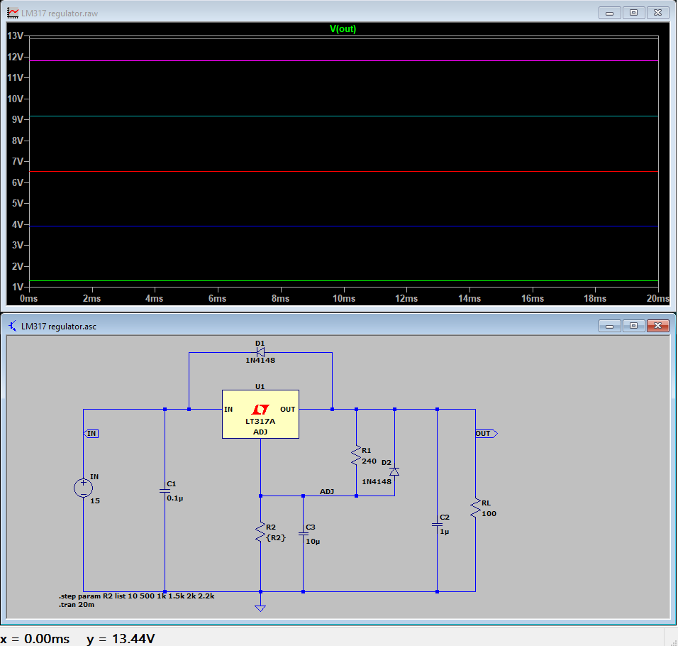
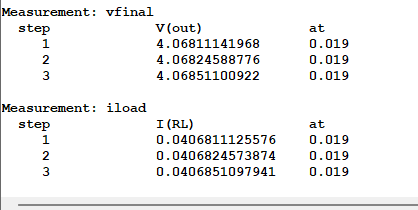
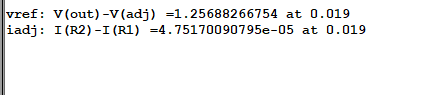

# Adjustable DC Power Supply (LM317)

A small bench supply built around the LM317: 15 V DC in, adjustable output, on a 40 × 40 mm board. Designed and verified in LTspice, PCB layout in KiCad.

**Status:** simulation and thermal design done. KiCad schematic and layout in progress.

## Spec

| | |
|---|---|
| Input | 15 V DC wall adapter |
| Output | 1.25 V to 11.8 V |
| Max current | 1 A above 9.3 V out, derated below that (see Thermal) |
| Board | 40 × 40 mm |

## Repository

```
simulation/   LTspice files (.asc)
images/       plots and measurement logs
kicad/        schematic and PCB (to come)
```

## Circuit



The LM317 keeps 1.25 V between OUT and ADJ, so R1 carries a fixed 5.2 mA and R2 sets the output:

```
Vout = 1.25 V × (1 + R2/R1) + I_ADJ × R2
```

| Part | Value | Why |
|---|---|---|
| R1 | 240 Ω | Sets 5.2 mA through the divider, which also covers the LM317's minimum load current |
| R2 | 2 kΩ pot | Output range. Limited to 2 kΩ because of dropout (see below) |
| C1 | 0.1 µF | Input decoupling |
| C2 | 10 µF | Output. 0.1 µF oscillated at 1 A in simulation |
| C3 | 10 µF | ADJ bypass, improves ripple rejection |
| D1, D2 | 1N4148 | Give the capacitors a safe discharge path if the input or output is shorted |

All measurements below were taken with LTspice `.meas` statements (screenshots of the logs are at the bottom).

## Results

### Compared with a discrete regulator

Before the LM317 I simulated a Zener + emitter-follower regulator (4.7 V Zener, 2N2222, 240 Ω feed resistor) to see what a regulator without feedback does. Both were set to about 4 V out.

| | Zener + transistor | LM317 |
|---|---|---|
| Load regulation, 4 to 80 mA | 2.51 % | 0.0033 % |
| Line regulation, 12 to 18 V in | 5.88 mV/V | 0.079 mV/V |
| Drift, −20 to 85 °C | 152.9 mV | 0.40 mV |

The Zener circuit sags under load because V_BE rises with current and the base current is taken from the Zener. Nothing corrects it. The LM317 compares its output against an internal reference and is two to three orders of magnitude better on every test.

The simulated LM317 also beats its own datasheet (typically 0.1 % load and 0.01 %/V line regulation). The SPICE model leaves out self-heating, lead resistance and part-to-part spread, so a real board will be worse.

### Output range

Sweeping R2 from 10 Ω to 2.2 kΩ gave 1.3 V to 12.9 V, matching the formula. The model ran about 0.5 % high: measuring it directly gave a reference of 1.2569 V and an ADJ current of 47.5 µA, and with those values the formula matches the simulation exactly. A real LM317's reference can be anywhere from 1.20 to 1.30 V, so the pot takes care of this.

### Load step

Load stepped from 10 mA to 1 A and back.


| C2 | Dip at 1 A step | Overshoot on release |
|---|---|---|
| 0.1 µF | oscillates continuously | |
| 1 µF | −256 mV | +177 mV |
| 10 µF | −148 mV | +108 mV |

The steady output changed by only 0.33 mV between 10 mA and 1 A. With 0.1 µF the regulator oscillated between 3.6 and 4.4 V for the whole time the load was on, which matches the datasheet's warning about small output capacitors. I went with 10 µF.

### Ripple rejection

2 V p-p of 100 Hz ripple on the input.

| C3 | Output ripple | Rejection |
|---|---|---|
| none | 168.8 µV | 81.5 dB |
| 10 µF | 69.1 µV | 89.2 dB |

Without C3, ripple at ADJ is amplified by the divider gain (1 + R2/R1 = 3.2, or 10 dB). C3 removes that, so 10 dB is the most it can help at this output, and it gave 7.8 dB. The gain is higher at higher output voltages, so C3 matters more there.

### Dropout

Input ramped down from 18 V with the output set to 12.88 V.

| Load | Dropout |
|---|---|
| 0.1 A | 1.88 V |
| 0.5 A | 2.05 V |
| 1 A | 2.23 V |

At 1 A the top setting needs 15.01 V in, and a real LM317 needs up to about 2.5 V. A 15 V adapter can't hold 12.9 V, so R2 is capped at 2 kΩ, giving 11.8 V max. That needs about 14.3 V at 1 A with real-world dropout, which still works if the adapter is 5 % low.

### Thermal

The LM317 dissipates (Vin − Vout) × I. Worst case is 13.75 W (1.25 V out at 1 A), which would need a heatsink much bigger than the board.

Heatsink: Assmann WSW V6560W (DigiKey AE10901-ND), 10 K/W, stands upright with a 30 × 12 mm footprint. TI gives RθJC = 0.1 °C/W for the tab. I designed with a more conservative 4 °C/W plus 1 °C/W for the thermal pad, which limits dissipation to 5.7 W at 40 °C ambient. With TI's figure the junction would sit around 103 °C at that limit, leaving margin below 125 °C.

| Output | Max current |
|---|---|
| 1.25 V | 0.41 A |
| 5 V | 0.57 A |
| 9 V | 0.94 A |
| 9.3 V and up | 1 A |

Above these limits the LM317's thermal shutdown kicks in.

The TO-220 tab is connected to OUT, so the heatsink will sit at the output voltage. Its pins can't go to ground on the PCB.

## Next steps

- [ ] KiCad schematic
- [ ] Custom footprint for the V6560W heatsink
- [ ] PCB layout, 40 × 40 mm

<details>
<summary>Zener regulator plots</summary>


</details>

<details>
<summary>LM317 plots</summary>


</details>

<details>
<summary>Measurement logs</summary>






</details>
