# Adjustable DC Power Supply (LM317)

A small bench supply built around the LM317: 15 V DC in, adjustable output, on a 40 × 40 mm board. Designed and verified in LTspice, PCB layout in KiCad.

**Status:** simulation, thermal design and PCB layout done. Not built yet.

## Spec

| | |
|---|---|
| Input | 15 V DC wall adapter |
| Output | 1.25 V to 11.7 V |
| Max current | 0.2 A at 1.25 V up to 0.86 A at 11.7 V, limited by the heatsink (see Thermal) |
| Board | 40 × 40 mm |

## Repository

```
simulation/   LTspice files (.asc)
images/       plots and measurement logs
kicad/        schematic, PCB, custom footprint library and Gerbers
```

## Circuit

The LM317 keeps 1.25 V between OUT and ADJ, so R1 carries a fixed current and the pot (RV1) sets the output:

```
Vout = 1.25 V × (1 + RV1/R1) + I_ADJ × RV1
```

| Part | Value | Why |
|---|---|---|
| R1 | 120 Ω | Sets 10.4 mA through the divider, which meets the LM317's worst-case 10 mA minimum load current |
| RV1 | 1 kΩ multi-turn trimmer | Sets the output. With R1 = 120 Ω, full scale is 11.7 V, below the dropout limit (see below) |
| C1 | 0.1 µF | Input decoupling |
| C2 | 10 µF, 105 °C | Output. 0.1 µF oscillated at 1 A in simulation |
| C3 | 10 µF, 105 °C | ADJ bypass, improves ripple rejection |
| D1, D2 | 1N4002 | Give the capacitors a safe discharge path if the input or output is shorted (1N4148 in simulation) |

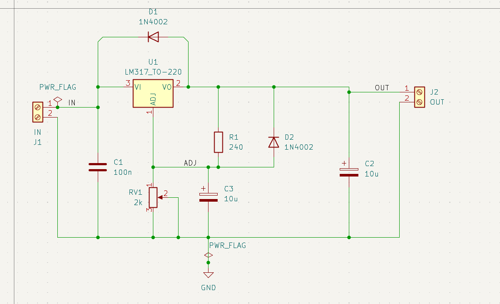

*Figure 1: KiCad schematic.*

The simulations below were run with R1 = 240 Ω and the pot as R2 (up to 2.2 kΩ). I later changed to R1 = 120 Ω and a 1 kΩ pot, because a 1 kΩ trimmer was what I could buy locally. The ratio is the same, so the output voltages are unchanged, and the higher divider current only helps regulation at light load.

All measurements were taken with LTspice `.meas` statements (screenshots of the logs are collapsed at the bottom).

## Results

### Compared with a discrete regulator

Before the LM317 I simulated a Zener + emitter-follower regulator (4.7 V Zener, 2N2222, 240 Ω feed resistor) to see what a regulator without feedback does. Both were set to about 4 V out.

| | Zener + transistor | LM317 |
|---|---|---|
| Load regulation, 4 to 80 mA | 2.51 % | 0.0033 % |
| Line regulation, 12 to 18 V in | 5.88 mV/V | 0.079 mV/V |
| Drift, −20 to 85 °C | 152.9 mV | 0.40 mV |

The Zener circuit sags under load because V_BE rises with current and the base current is taken from the Zener. Nothing corrects it. The LM317 compares its output against an internal reference and is two to three orders of magnitude better on every test.

The simulated LM317 also beats its own datasheet (typically 0.1 % load and 0.01 %/V line regulation). The SPICE model leaves out self-heating, lead resistance and part-to-part spread, so a real board will be worse.


*Figure 2: Zener regulator output for loads from 50 Ω to 1 kΩ. The output drops about 100 mV as the load increases.*

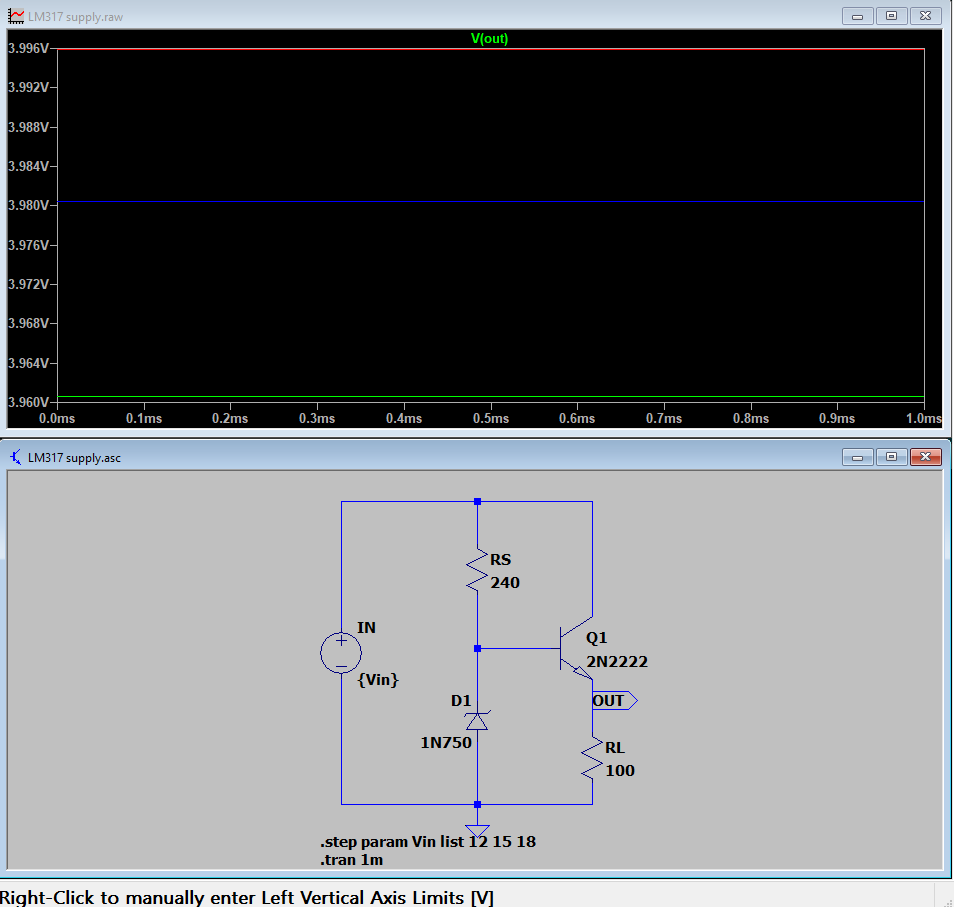

*Figure 3: Zener regulator output for 12, 15 and 18 V input.*


*Figure 4: Zener regulator output at −20 °C and 25 °C. The 85 °C trace (4.066 V) is above the plotted window.*

### Output range

Sweeping R2 from 10 Ω to 2.2 kΩ gave 1.3 V to 12.9 V, matching the formula. The model ran about 0.5 % high: measuring it directly gave a reference of 1.2569 V and an ADJ current of 47.5 µA, and with those values the formula matches the simulation exactly. A real LM317's reference can be anywhere from 1.20 to 1.30 V, so the pot takes care of this.


*Figure 5: LM317 output for R2 from 10 Ω to 2.2 kΩ (15 V in, 100 Ω load).*

### Load step

Load stepped from 10 mA to 1 A and back.

| C2 | Dip at 1 A step | Overshoot on release |
|---|---|---|
| 0.1 µF | oscillates continuously | |
| 1 µF | −256 mV | +177 mV |
| 10 µF | −148 mV | +108 mV |

The steady output changed by only 0.33 mV between 10 mA and 1 A. With 0.1 µF the regulator oscillated between 3.6 and 4.4 V for the whole time the load was on, which matches the datasheet's warning about small output capacitors. I went with 10 µF.


*Figure 6: Load step with C2 = 1 µF. Short dip when 1 A is applied at 10 ms, overshoot when it is released at 15 ms.*


*Figure 7: The same step with C2 = 0.1 µF (green, oscillating), 1 µF (blue) and 10 µF (red).*

### Ripple rejection

2 V p-p of 100 Hz ripple on the input.

| C3 | Output ripple | Rejection |
|---|---|---|
| none | 168.8 µV | 81.5 dB |
| 10 µF | 69.1 µV | 89.2 dB |

Without C3, ripple at ADJ is amplified by the divider gain (1 + R2/R1 = 3.2, or 10 dB). C3 removes that, so 10 dB is the most it can help at this output, and it gave 7.8 dB. The gain is higher at higher output voltages, so C3 matters more there.

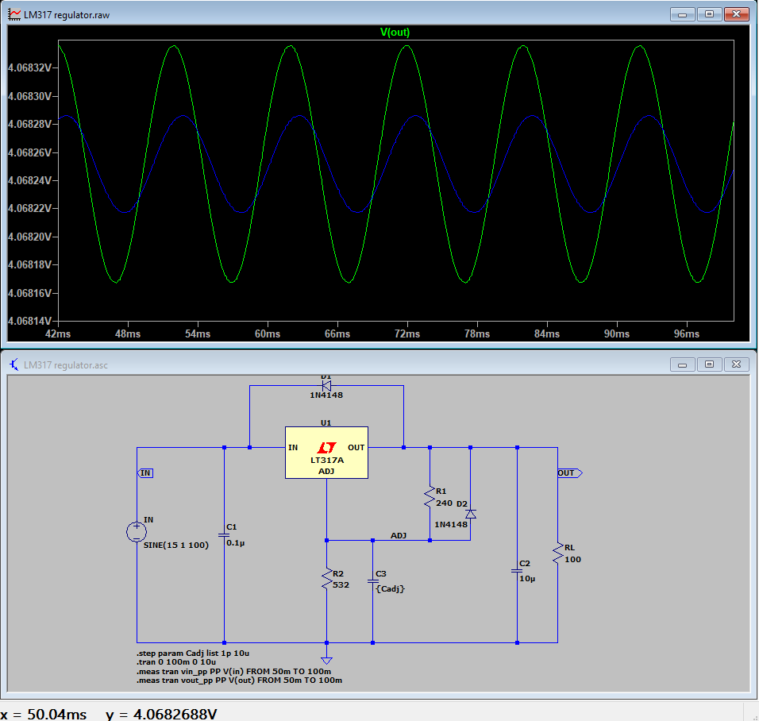

*Figure 8: Output ripple without C3 (green) and with C3 = 10 µF (blue).*

### Dropout

Input ramped down from 18 V with the output set to 12.88 V.

| Load | Dropout |
|---|---|
| 0.1 A | 1.88 V |
| 0.5 A | 2.05 V |
| 1 A | 2.23 V |

At 1 A the top setting needs 15.01 V in, and a real LM317 needs up to about 2.5 V. A 15 V adapter can't hold 12.9 V, so the maximum is set to about 11.7 V (originally R2 = 2 kΩ with R1 = 240 Ω, now a 1 kΩ pot with R1 = 120 Ω). That needs about 14.2 V at 1 A with real-world dropout, which still works if the adapter is 5 % low.

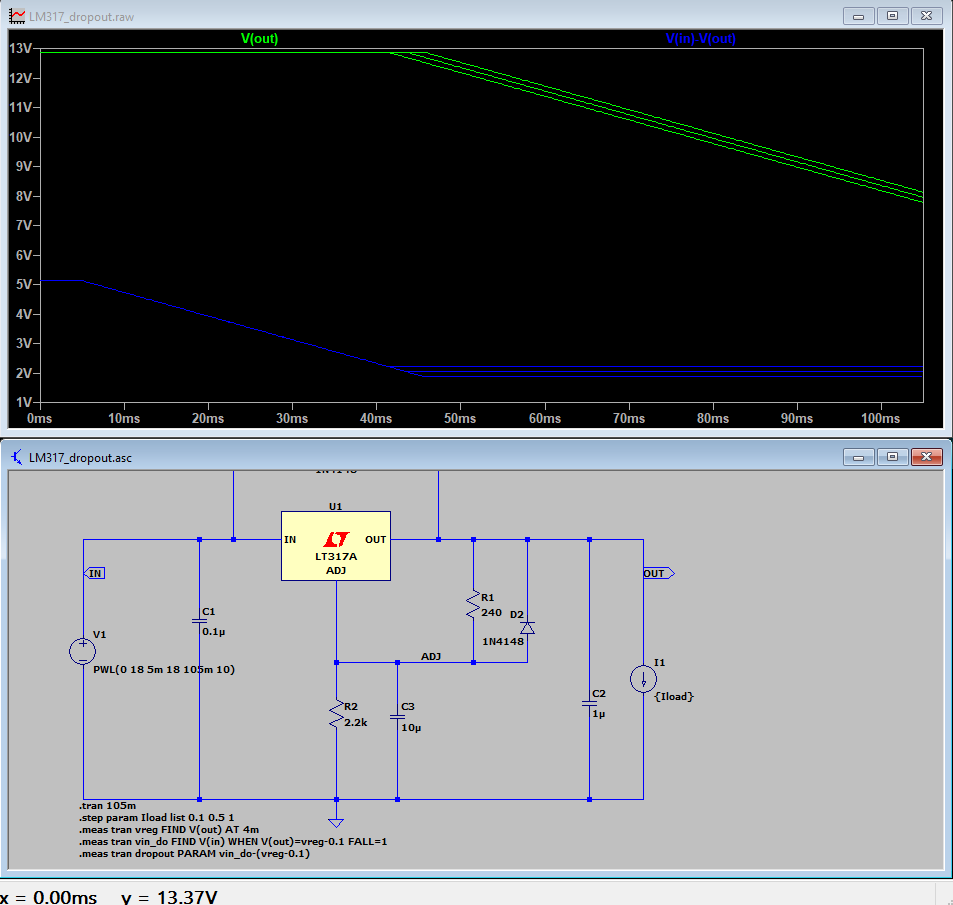

*Figure 9: Output (green) and input-output difference (blue) as the input ramps from 18 V down to 10 V, for 0.1, 0.5 and 1 A. Time runs left to right, so the input falls left to right.*

### Thermal

The LM317 dissipates (Vin − Vout) × I. Worst case is 13.75 W (1.25 V out at 1 A), which would need a heatsink much bigger than the board.

I first designed around an Assmann WSW V6560W board-mount heatsink (10 K/W). With a conservative 4 °C/W junction to case (TI gives 0.1 °C/W) and 1 °C/W for the thermal pad, that allows 5.7 W at 40 °C ambient: 1 A from about 9.3 V out upwards.

I couldn't get that heatsink in Jordan, so the board uses a small clip-on TO-220 heatsink instead (15 × 10 × 20 mm, Mikroelectron ME-13388). It has no published rating. Heatsinks that size are typically around 20 to 25 °C/W, so I assume 25 °C/W, which gives (125 − 40) / (4 + 1 + 25) ≈ 2.8 W:

| Output | Max current |
|---|---|
| 1.25 V | 0.21 A |
| 5 V | 0.28 A |
| 9 V | 0.47 A |
| 11.7 V | 0.86 A |

Above these limits the LM317's thermal shutdown kicks in. If the board is ever built, measuring the heatsink's real thermal resistance would replace the 25 °C/W assumption.

The TO-220 tab is connected to OUT, so the heatsink sits at the output voltage. It shouldn't touch anything grounded, like a metal case or a scope ground clip.

## PCB

Two-layer, 40 × 40 mm, all through-hole so it can be hand-soldered. Layout choices:

- The LM317 sits along the top with the clip-on heatsink behind its tab. The heatsink has no pins, so its footprint is just an outline that keeps the space clear.
- Input comes in on the right (J1), straight into C1 and the LM317's IN pin. Output leaves on the left (J2) on a direct track from the OUT pin.
- R1 sits right under the LM317 with its own track to the OUT pin, so load current doesn't flow through the feedback path. The datasheet asks for this.
- IN, OUT and GND use 1.0 mm tracks (about 0.3 mm would do for 1 A on 1 oz copper). ADJ uses 0.5 mm.
- The bottom layer is a solid GND pour, so ground needs no tracks.
- The output is set with a multi-turn trimmer (3296W-style), adjusted with a screwdriver.
- Two M3 mounting holes along the bottom edge.

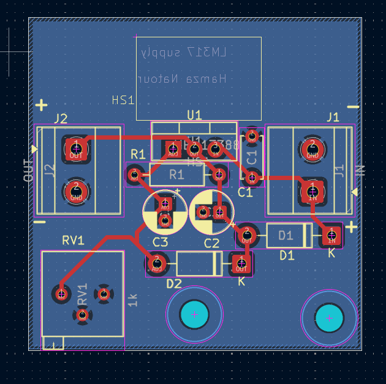

*Figure 10: PCB layout. Top copper in red, bottom GND pour in blue.*

Changes from the simulation: the protection diodes are 1N4002 instead of 1N4148, because on a real board they have to carry the capacitors' discharge current, and the datasheet suggests 1N4002-type parts. C2 and C3 should be 105 °C electrolytics, since they sit close to the regulator. The heatsink and pot were swapped for parts available locally, as described above.

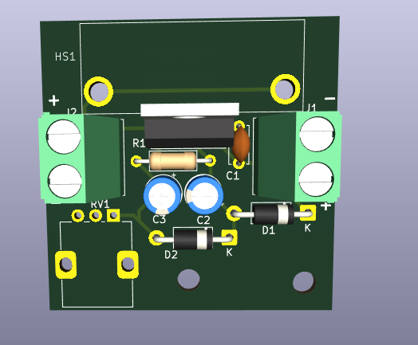

*Figure 11: 3D render, top. The heatsink has no 3D model, so only its outline shows.*

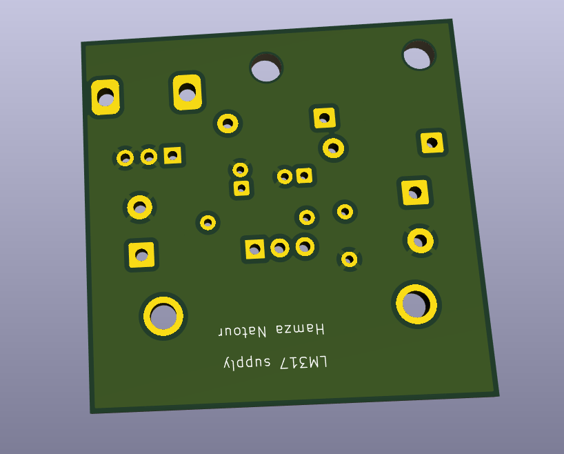

*Figure 12: 3D render, bottom, with the ground pour and board label.*

## Next steps

- [ ] Re-run the output range simulation with R1 = 120 Ω and a 1 kΩ pot
- [ ] Order boards and parts, build and test it against the simulation
- [ ] If built: measure the heatsink's real thermal resistance

<details>
<summary>Measurement logs</summary>

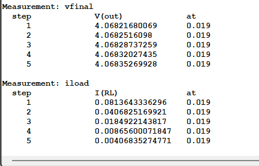


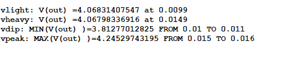

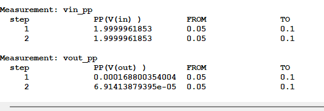
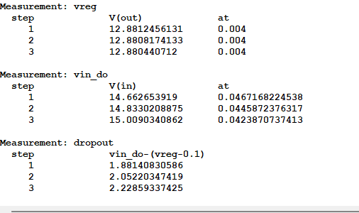
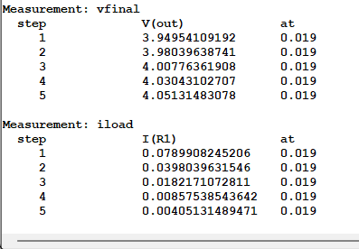


</details>
